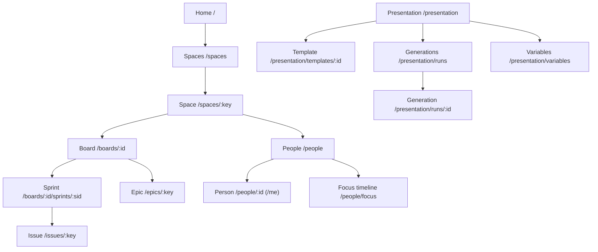

# Pages

What each screen of the web app shows, page by page. Labels are the en-US catalogue's
(`web/src/i18n/locales/en-US/`); how each indicator is calculated is in `shell.help`
(`lib/indicatorHelp.ts`). URLs, `?tab=` values and the redirects from older addresses are in
[routes.md](routes.md). Example ids below (space `AI`, board 467, sprint 2896) are placeholders.

The pages follow the domain's levels: **Home → Space → Board → Sprint → Issue**, with epics beside
the boards (their children can span several). Each thing lives at the level it belongs to: a board's
flow, hygiene and settings are tabs of the board; a space's tabs are the same views over all its
tracked boards.

## Follow

- **Home**: URL `/`
  - A customizable grid of tiles: drag them, size them S/M/L, add or remove them. The layout is
    saved per signed-in user (`home.layout.<user>`).
  - Indicator tiles:
    - **Items at risk**: open items that fire any risk rule, summed across boards.
    - **Throughput**: items done this weekly window, compared with the previous window.
    - **Average progress**: done ÷ sprint items, averaged across boards.
    - **Commitment adherence**: delivered ÷ committed, closed sprints only.
    - **Added scope**: items that entered after the sprint started.
  - People tiles:
    - **Team load**: open hours ÷ capacity left.
    - **People over capacity**: anyone above 110% load.
    - **Active blocks**: how many, how severe, how long.
    - **Sprint deliveries**: delivered against committed.
  - Activity tiles:
    - **Recent deliveries**: items done per day over 7 days, against the 7 before.
    - **Happening now**: delivered, blocked or added in the last 48 h.
    - **Due in 7 days**: items due soon, plus those already overdue.
  - Team tiles:
    - **Spaces** (default): one row per team — tracked boards, items at risk, delivered this week
      against last, sprint progress — each linking to the space.
    - **Boards table** (optional): one row per board with Space, Sprint, Progress, Risk,
      Throughput, Trend and Data freshness.
  - System tile:
    - **Data hygiene**: points of attention such as unestimated items.

- **Spaces**: URL `/spaces`
  - One card per team with a tracked board: its boards, items at risk, delivered this week and
    sprint progress (done ÷ items over the running sprints, summed across its boards).

- **Space**: URL `/spaces/AI`
  - Header: the space's key and how many tracked boards it has.
  - Tabs:
    - **Overview** (`overview`): items at risk by situation, delivered this week against last,
      sprint progress, then the space's board cards (and how many of its boards are not tracked).
    - **People** (`people`): the team's person cards, with load, deliveries and blocks measured on
      this space's boards only.
    - **Open items** (`risks`): open items at risk across the space's boards, with a Board column and
      the evidence behind each.
    - **Flow** (`flow`): the flow KPIs and charts over all the space's boards (cumulative flow,
      cycle time and aging are per board, on each board's Flow tab).
    - **Data hygiene** (`hygiene`): Jira hygiene problems of each of the space's boards.

- **Boards**: URL `/boards` (`?kind=scrum|kanban`)
  - **Board cards**: one per tracked board, ordered by space, with search and a kind filter. Each
    card shows:
    - Sprint progress, with a mark for time elapsed (or, without a sprint, delivered this week
      against last).
    - A trend sparkline.
    - Items at risk and data freshness.
    - **Flow metrics**: a link to the board's Flow tab.

- **Board**: URL `/boards/467` — the same page whether or not a sprint is running.
  - Header: crumbs Home / space / board, and the running sprint's name.
  - Tabs:
    - **Overview** (`overview`): the running sprint as a card with a button into it; items by risk
      situation over all open work; Monte Carlo forecast; the weekly windows (delivered, entered,
      left, unmoved).
    - **Sprints** (`sprints`): every sprint with state and period.
    - **Work tree** (`work-tree`): the item hierarchy with done ratio and estimate rollup.
    - **Open items** (`risks`): open items by situation (carried over, overdue, blocked, stalled,
      aging), each with its evidence.
    - **Flow** (`flow`), filtered by type and period:
      - KPIs: completed items; lead time P85 and cycle time P85; work in progress (daily average);
        flow efficiency; commitment adherence and carry-over rate (medians of closed sprints);
        reopen rate and backward moves.
      - Charts: throughput per week; work distribution by type; cumulative flow; cycle time
        scatter; aging WIP; committed vs delivered per sprint.
      - Export items.
    - **What changed** (`changes`): the board against a checkpoint, or two checkpoints (open, done,
      at risk, open points; new risks, resolved, completed, entered, left, moved, reassigned,
      reopened).
    - **Data hygiene** (`hygiene`): this board's Jira hygiene problems, each with where to fix it.
    - **Settings** (`settings`): the board's profile — WIP and active columns, blocking statuses,
      checkpoint day/hour/time zone, stall and aging thresholds, capacity, focus factor, hours per
      point, load thresholds, affinity. Leaving the tab with unsaved edits asks first.

- **Sprint**: URL `/boards/467/sprints/2896` (e.g. "Sprint 4.2"). Has a sprint switcher; the header
  shows the period and the goal; crumbs Home / space / board / sprint.
  - Tabs:
    - **Overview** (`overview`):
      - Progress by count and by points, with estimate coverage.
      - Risk by item.
      - Monte Carlo forecast: probability of finishing in time, and P50/P85/P95 dates.
    - **Work tree** (`work-tree`): members, their subtasks and ancestors, with done ratio and
      estimate.
    - **Timeline** (`timeline`), the reference for every timeline: a summary by state and risk
      whose chips filter, the sprint's day, by hierarchy or by person, search, state and at-risk
      filters, subtasks, zoom and today, weekends, the sprint's end, a date cursor counting what was
      in progress, carried-over and added marks, due-date diamonds, and a detail drawer with
      previous/next and keyboard navigation.
    - **Open items** (`risks`): the sprint's items by situation, with evidence.
    - **What changed** (`changes`): only this sprint's checkpoints. A running sprint compares its
      last checkpoint with now; a past one, its first checkpoint with its last.
    - **Committed × delivered** (`commitment`):
      - Committed, delivered, remaining, removed and added later.
      - Adherence.
      - Carry-over rate (closed sprints only).
    - **Allocation** (`allocation`):
      - Heuristic allocation, with planned vs actual load per person and per item.
      - Assignment adherence.
      - A "What if…?" capacity simulation.

- **Epic**: URL `/epics/KEY-1` (`?board=467` is the board it was opened from)
  - Header: status, due date and description; crumbs back to the space, board and sprint.
  - Tabs:
    - **Overview** (`overview`): progress, risk counts, estimate total (points), forecast and work
      tree.
    - **Plan** (`plan`):
      - Summary: total hours, baseline days against plan days and the gain.
      - Team and capacity.
      - Estimate and overhead breakdown.
      - Task/subtask pipeline.
      - Weekly Gantt: role chips that filter, search, expand/collapse, Fit/Days/Hours, a cursor
        reading week, day, hour and how many bars run, arrow keys between bars; a bar opens its
        task.
      - Scheduling with greedy, MILP or CP-SAT.
      - Subtask roles, Jira problems and a readiness checklist.
      - Parameters.

- **Issue**: URL `/issues/KEY-123`
  - Risk situation with evidence, the description and an "Open in Jira" link.
  - Time metrics: lead, cycle, queue, blocked and active time.
  - Flow efficiency, backward moves, and whether it was ever reopened.
  - Parent and children, and status/column history.

- **People**: URL `/people`
  - **Person cards** grouped by space: role, load gauge, deliveries, blocks and the last 6 sprints.
    Numbers only, alphabetical.
  - An "Only who has activity in the sprint" switch, on by default.
  - Drawers:
    - **Roles and team**: `?roles=1`.
    - **Absences**: `?absences=1`.
  - **My week**: `/me` opens your own person page (Week tab); until this browser knows who you are
    it opens the picker here (`?tab=my-week`).

- **Person**: URL `/people/<accountId>`
  - Summary: load, deliveries, blocks, past sprints.
  - Tabs:
    - **Week** (`week`):
      - Signals: overload, blocks, overdue, stalled, due soon.
      - Items in progress, and items finished since Monday.
      - Open work.
    - **Timeline** (`timeline`): the sprint timeline's component over the last 8 weeks — the
      person's items under their epics (one group per board when they work on several), with the
      state summary and chips, search, state and at-risk filters, subtasks, zoom, today, weekends,
      a date cursor, due marks and a detail drawer with previous/next and keyboard navigation.
    - **Capacity** (`capacity`): per sprint, capacity against committed and delivered hours, plus
      availability and absences.
    - **History** (`history`, 6, 12 or 26 weeks):
      - Completed items, against the boards' median.
      - Cycle time and lead time P85.
      - Unplanned items.
      - Delivered/committed trend.
    - **Role** (`role`): the person's roles and descriptions.

- **Focus timeline**: URL `/people/focus`
  - The team's log of activities and focus shifts, as a grid (person × day) or a list.
  - Day/week/month granularity, period presets and search.
  - Themes and signals tagging.
  - Drag a card to another day or person to reassign it, with undo/redo.

## Deliver

- **Presentation (templates)**: URL `/presentation`
  - The gallery of uploaded `.pptx` templates; upload, manage and open one. Links to Generations
    and Variables.

- **Template editor**: URL `/presentation/templates/<id>` (`?run=`, `?slide=`, `?shape=`,
  `?wizard=1`)
  - Ribbon tabs: File, Home, View, Insert, Format, Slide, Arrange, Tools, Present, Help.
  - Slide filmstrip and a canvas that edits text in place.
  - Right rail with Properties, Comments, Find and the bindings list.
  - Drawers about this template:
    - **Generate**: reference date, boards, audience, anonymize, notify, a one-board preview, the
      readiness report, and this template's generation history (each row opens its page).
    - **Variables**, **Presentation rules**, **Narrative per board**, **Edit versions**,
      **Templates**, **Diagnostics**, **Accessibility**, **Usage**, **Template wizard**.
  - **Present mode**: timer, notes, pen/laser, "Refresh numbers" and an audience window.

- **Generations**: URL `/presentation/runs` (`?template=` narrows to one template)
  - Every generated deck, newest first: when, which template, reference date, validation and
    review state.

- **Generation**: URL `/presentation/runs/<id>`
  - Validation errors and warnings, each with a link that opens the editor (or the variables) where
    it is fixed.
  - Download .pptx / PDF, share link, questions, partial regeneration, review and approval,
    accessibility, the rendered deck and "Present from here". Reviewers never need the editor.
  - A generation whose template was deleted still offers its file.

- **Variables**: URL `/presentation/variables` (`?template=`)
  - The variable manager for one template at a time: variables bound to the template or shared,
    their values per slide, board, space and global, the Jira fields catalogue and the status
    colours.

## System

- **Collection status**: URL `/status`
  - Tabs:
    - **Collection** (`collection`):
      - Tracked boards: last success, last full collection, last run, counters, error cause.
      - Recent runs: mode, status, calls, waits, retries, errors.
      - Live progress with ETA, and cancel.
    - **Data hygiene** (`health`): Jira hygiene problems of every tracked board at once (each board
      and space has its own tab too).

- **Settings**: URL `/settings?tab=…` — only what applies everywhere.
  - System: `connection` (Jira), `calendar` (checkpoints), `collection`, `email` (SMTP), `ai`,
    `general` (locale and the like).
  - Jira: `boards` (which boards are tracked; a tracked board's name opens its Settings tab),
    `fields` (custom field ids).
  - Delivery: `notifications` (channels and digest), `epic-plan` (planning parameters).

- **Setup**: URL `/setup` (`?phase=configure|first-run`)
  - **Configure**: Jira, Calendar, Collection, E-mail, AI, Review — nothing is saved until the
    last step.
  - **First run**: discover boards and fields, choose the boards to track, run the first
    collection, then go to the deck.
  - Opens on *first run* when Jira is already configured.

## Outside the app shell (no menu)

- **Shared deck**: `/shared/:token`, a public read-only deck that can expire or be revoked.
- **Audience window**: `/present/audience?channel=…`, synced with the presenter's window.

## Available on every page

- Command palette (Ctrl+K) and shortcut help (`?`).
- Collection-freshness pill in the header.
- The shared URL filters (`board`, `person`, `type`, `start`, `end`, `situation`) are kept on
  drill-down links.
